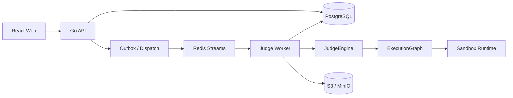

# 架构基线

契约状态：**proposed / 0.1.0-draft**。当前工程实现不等于设计冻结。冻结需要 P0-004 的独立 Architect Review，详见 PROGRESS.md。

## 目标与边界

采用 Go 模块化控制平面与独立 Judge Worker。前端通过 REST 访问 API；API 管理身份、题目和提交，永不执行选手代码。数据库为业务事实来源；Redis Streams 从 Phase 3 起承担至少一次任务投递；对象存储保存不可变源码、数据、产物和日志对象。

上图是目标拓扑，不是当前已实现能力。当前只有 HTTP 基础接口、空闲 Worker 和类型草案。

## 包依赖

- apps/api → internal/httpapi → domain / repository ports / platform adapters。
- services/judge-worker → judge → execution / sandbox ports → Linux runtime adapter。
- domain 只依赖标准库；不引入 HTTP、数据库、Redis、Docker。
- HTTP 层不得导入 judge、sandbox、execution 实现或 os/exec。API 独立部署不得持有运行选手代码的权限。
- adapters 实现业务定义的接口；禁止 domain 反向依赖基础设施。
- 核心代码放单一 Go module；尚未使用的组件按阶段建立，避免过早拆微服务。

## 事务与仓储边界

Phase 2 创建 Submission 时，在单个 DB 事务写入 Submission、完整 SourceUnit 快照和首个 JudgeRun；不能出现部分角色成功保存。Phase 3 同一事务还写 outbox，后续发布到 Redis；不能先提交 DB 再以无恢复手段的单次网络调用投递任务。

结果事务包含 TestcaseResult / CompiledArtifact 记录、Run 终态及审计事件，以 run ID + attempt/fence 条件更新。事务提交成功才 ACK；重投先查终态，已提交结果不重复改写。传输 attempt 与业务 rejudge 分离。

Repository 接口围绕业务事务定义，例如 CreateSubmissionSnapshot / CommitRunResult，而非要求 Service 拼接多个各自提交的 CRUD。具体签名、锁与约束在 Phase 2/3 设计冻结后实现，本次未建立业务表。

## 失败与并发

- Compiler、Contestant、Checker/Interactor 的信任与计量边界分别定义。
- 用户程序异常与基础设施失败分离，见 STATE_MACHINE。
- Queue 重领、lease 过期和旧 Worker 回写通过 fencing 防止陈旧提交。
- Sandbox 不提供“隔离失败就普通进程执行”的降级。
- Shutdown 先停止接单，再处理/取消在途任务并完成清理；未提交结果的消息不得 ACK。
- 原始源码与版本记录持久保存；rejudge 不覆盖历史 JudgeRun。

## 当前非目标

不实现认证、题库 CRUD、数据库业务迁移、提交执行、Queue 消费、Linux 隔离、分布式调度、Kubernetes 或生产可观测性。Phase 0 的真实 checks 见验证记录。下一阶段由 ROADMAP 和任务卡推进。
