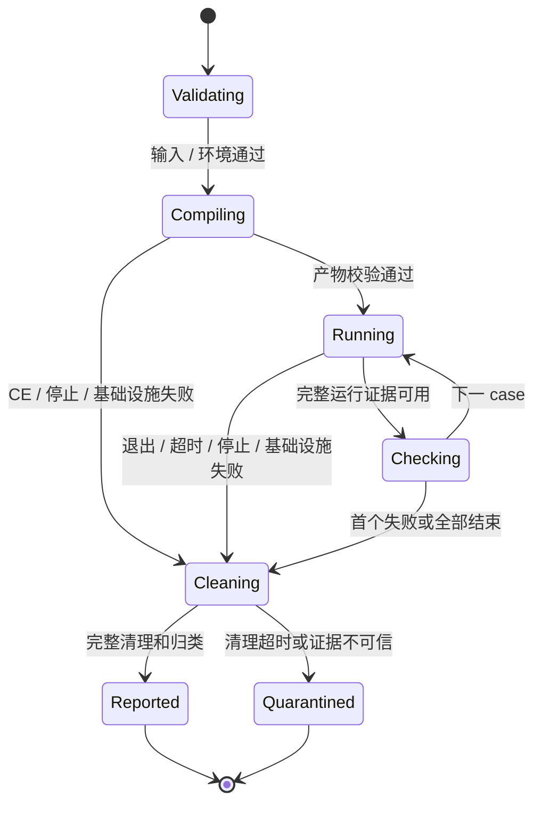

# Phase 1：可信 fixture 的 Local Mini Judge 设计

- 版本 / 状态：mini-judge/0.1.0-draft / proposed，尚未独立设计审阅或冻结。
- 作者：根 Agent / Architect，2026-10-01（Asia/Shanghai）；任务 P1-001。
- 基础依赖：[Phase 0 验收](../reviews/2026-10-01-phase0-acceptance.md)；[foundation-invariants/1.0.0](../architecture/FOUNDATION_INVARIANTS.md)。
- Review owner：[P1-002](../tasks/P1-002-design-review.md) 的独立 Architect；Phase 0 审阅不能替代本设计审阅。
- 实施任务：[Agent 任务包](PHASE1_AGENT_TASKS.md)；测试输入：[fixture 规范](PHASE1_FIXTURES.md)；生命周期裁定：[ADR-0003](../adr/0003-phase1-local-runner-lifecycle.md)。

本文是拟实现契约和验收方案，所有 CLI、接口、运行指标均未实现 / 未执行。代码仍保留 Phase 0 草案。

## 1. 目标、非目标与信任边界

完成单机、串行、C++20 的源码快照 → 编译 → stdin / stdout → Exact Checker → CLI JSON 结果，至少用真实 Linux fixture 复现 AC / WA / CE / RE / TLE。清理、取消和基础设施失败也必须可观测。

只运行仓库维护者审查并列入 fixture manifest 的源码；显式选择 trusted-fixture 模式，源 hash 和路径匹配才启动。CLI 不接收网络提交、任意未登记源码、用户提供的 compiler flags 或 shell 命令；API / Web / idle Worker 不接入此 runner。

不实现认证、业务 DB、S3、队列、fence、并发调度、SPJ / Interactor / 通信图，也不实现 Phase 4 的恶意代码隔离。开发 runner 单独放 `internal/devrunner`，不冒充已有 `sandbox.Runtime` 的生产实现，不提供“缺少隔离就普通进程执行”的自动回退。Phase 4 前不开放外部任意源码执行。

## 2. 实际环境与实现前置

当前只读核实的环境：Windows amd64，Go 1.25.4 / Node 22.19.0；Docker Linux engine 29.8.1，kernel `6.6.87.2-microsoft-standard-WSL2`，cgroup v2 / cgroupfs。以上只证明基础服务能运行。

**尚未锁定 / 验证：** C++ 编译器与 runtime 镜像 digest、Linux Go 工具链、runner 用户 / 目录、受委派 cgroup 子树及所需操作权限、clone3 允许情况、subreaper / 精确清理 / 实际计量。设计交付不依赖先装这些组件，执行实现依赖 P1-010 的真实 preflight。

P1-010 选用专用 Linux 开发环境，记录 OS / kernel / arch、Go 和 `g++ --version` 的完整版本、编译器路径及 hash、runtime 镜像 digest（若采用镜像）、libc、locale、uid、fixture root 与工作根。禁止仅锁 mutable tag 或写“使用最新版本”。默认 flags 固定 `-std=c++20 -O2 -pipe`，不采用尚未核实的静态链接；compiler 绝对路径由受审 profile 给出。

preflight 必须以实际 runner 用户验证创建 / 配置 / 读取 / 删除专属 cgroup、所需控制器、原子子进程归属、kill 与 reaping、tmp 配额及写权限，输出结果文件。Docker VM 有 cgroup v2 不意味着普通容器已获委派；不全局 chmod `/sys/fs/cgroup`，不挂宿主 Docker socket 给程序。缺项就拒绝启动，单独记录并停止实现，不改主机全局策略。

## 3. 输入快照、身份和产物

本阶段只允许一个 role=`contestant` 的 SourceUnit，每 Run 最多 16 个 testcase，按 manifest 顺序串行，编译一次。源文件 ≤256 KiB，单份 stdin / expected ≤1 MiB；内容、case 顺序、版本及限制在开始时读取并固定，拒绝 path traversal、越界 symlink、重复 case ID、hash 不匹配、0 / 负 / 溢出限制。

每次 CLI 调用产生新 local RunID 和 SourceUnitID；开始后不重读“最新源码”。失败重试是新的 CLI Run，不覆写上一份报告，也不复用业务 rejudge / queue attempt 字段。版本 manifest 和实际 compiler / runtime / checker 标识写入报告，local ID 不宣称就是未来 DB ID 格式。

工作根下为 Run 创建独占目录，源快照、编译诊断、可执行产物、各 case stdout / stderr 分开。产物必须显式含 RunID / SourceUnitID / SHA-256 / 实际 compiler 与 runtime；每次执行前核对 hash 与身份，不用数组位置关联。路径只由 runner 生成；可执行产物不可在判题中被改写。

工作根不能是仓库、`.env`、Docker volume 或任意用户目录。清理前核对绝对路径处于固定根下且 RunID 相符；保留的有限报告 / 诊断复制到报告目录后再移除工作目录。失败也不得删除来源 fixture。

## 4. 分层接口提案

下列是 Phase 1 内部提案，不直接改变当前 `domain.JudgeJob` / `execution.Graph` / `sandbox.Runtime`：

| 组件            | 输入 → 输出                                                               | 责任                                                                                  |
| --------------- | ------------------------------------------------------------------------- | ------------------------------------------------------------------------------------- |
| FixtureLoader   | 受控路径、manifest、profile → ImmutableLocalRequest                       | 固定源码 / case 字节、hash、版本、正有限预算；不执行                                  |
| Compiler        | 源快照、CompileProfile、StageBudget → CompilationEvidence + 可选 Artifact | 固定 argv，无 shell；预算、编译诊断；只有退出 0、清理成功且产物通过校验才返回可执行物 |
| StageSupervisor | StageSpec、取消请求 → ProcessEvidence / InfraFailure                      | Linux 启动、cgroup 归属、输出计数、限时、wait / signal / descendants、完整清理        |
| LocalRunner     | Artifact、stdin、CaseBudget → ProcessEvidence                             | 只验证运行绑定并调用 supervisor；不判答案                                             |
| ExactChecker    | 完整且未截断的 stdout 与 expected → Match / Mismatch / CheckerFailure     | 字节严格比较；不启动外部程序                                                          |
| Pipeline        | ImmutableLocalRequest → LocalRunResult                                    | 编译 / 串行 case、错误映射、首个失败、报告；不接 DB 或 HTTP                           |
| CLI             | 参数 → Pipeline / stdout JSON / stderr 摘要                               | 参数、取消、退出码；不包含执行器内部实现                                              |

`ProcessEvidence` 至少包含 stage / role / case ID、start / stop 的 monotonic elapsed、raw exit code 或 signal、监督停止原因与序号、CPU usage、memory peak、输出实际计数 / 保留长度 / 截断标记、预算、cleanup 完成与子进程状态。未知值用 null + reason，不伪造 0。

领域结果和基础设施 error 分开：`error != nil` 或 context 结束不能直接映射选手 RE / TLE。清理 / 计量 / I/O 不可信时返回 SYSTEM_ERROR，保留有限部分证据且 `evidence_complete=false`；禁止部分 stdout 继续送 Checker。提案包含的额外字段需独立 review 后再定义 Go 类型，不能改冻结原则或借空 SourceUnitID 表示可信管理程序。

## 5. 生命周期与终态



上图是本地 pipeline 阶段，不是新增 DB RunState。future lifecycle 仍遵守终态不可变；本阶段报告只写一次，不能先输出 AC 再异步清理或更改结果。

编译失败不运行；每 case 有独立运行 cgroup 与输入 / 输出对象。正常完成后检查必要清理及完整证据，才比较答案。遇到首个非 AC case 停止其余 case，显式将未执行项标 `SKIPPED`；全部 case AC 才 Run AC。任何阶段 INFRA failure 使 Run SYSTEM_ERROR，不以先前已 AC 的 case 掩盖它。

## 6. 超时、退出和取消竞争

所有时间比较使用 monotonic clock，报告另外保存 UTC 作为日志时间，不用墙上时钟判 TLE。stage wall 起点是调用 Linux launch 之前，包含该次启动开销，不含 profile / 镜像准备；launch 失败是 INFRA。成功后预算不能从 `Start` 返回时重新计时。

每 stage 一个 arbiter，串行提交观察事件并分配 seq，不能让多个 goroutine 直接写 verdict。事件的 `observed_at` 是在 arbiter 锁 / 单 owner 中取得的时间；原始 wait 观察与最终管道 EOF 分开。

- raw exit 在 wall deadline **之前**提交观察且没有已有停止原因，登记 EXIT 候选；继续监督输出与清理，不立即报告 AC。
- raw exit 在 deadline 或之后才观察，归为 WALL_TIMEOUT；即使 timer callback 被调度延迟，不能放过截止后的 exit。
- timer / cancel 进入 arbiter 时检查已有 EXIT / stop；已登记的 EXIT 不被迟来的 timer 或取消覆盖。未有 exit 且 now≥deadline 时 wall 超时；now<deadline 的显式取消成为 CONTROL_CANCEL。
- CPU 使用量达到预算的可信观察独立记录。最后读取 CPU 与输出计数，不能因 exit 先被观察就跳过已经发生的超限；资源 guard、计量失败的归类见第 8 节。
- 同次检查同时触发 CPU / wall 时 reason 固定为 CPU_TIMEOUT；同时取消 / deadline 时到达 deadline 优先 WALL_TIMEOUT。不是以随机 select 分支确定原因。

判定基于监督器可证明的观察时点，**不声称知道内核精确退出的纳秒**；截止附近的 exit 可能保守判超时。这是本设计的策略选择，P1-002 必须审阅并用可控时钟事件测试固定行为，禁止实现者凭“看起来已退出”修改规则。

明确 CPU / wall 监督超时才 TLE；cleanup / I/O / checker / 整个 Job 运维预算超时是 SYSTEM_ERROR，不映射为选手 TLE。取消已赢得停止竞争时，完成清理后返回 CANCELLED；cleanup 失败优先 SYSTEM_ERROR，不能冒称已取消完成。

## 7. Linux 监督与完整清理

每 stage 使用独立叶子 cgroup，监督器在外；子进程启动时就归入该组。选择 Go 1.25.4 Linux `SysProcAttr.UseCgroupFD / CgroupFD` 方案时必须真实验证内核与权限，不能以“启动后再移动 PID”掩盖计量窗口。[Go 1.25.4 Linux 源码](https://github.com/golang/go/blob/go1.25.4/src/syscall/exec_linux.go) 支持该入口；具体 launcher 协议仍需设计审阅。

payload 创建独立进程组；单独杀 root PID / 进程组不作为完整进程树清理证明。每 stage 的独立 supervisor 设置 subreaper，由唯一 reaper 拥有 direct child 与被收养子孙的 wait；不能混用 `Cmd.Wait` 与并行 `wait4(-1)` 抢同一 child。CLI 只等待 supervisor 的完整结果，不自己争抢 payload exit。

停止后按专属 cgroup handle 清理并验证为空，再回收被收养子进程 / pipe goroutine / FD；全部在 cleanup 2000 ms 预算内完成。主进程退出但有后代仍活跃时也必须清理：可信 fixture 此行为归 RE / CHILD_REMAINS；compiler 不应遗留后代，否则 INFRA / COMPILER_CHILD_REMAINS。监督器自身意外退出则 stage 失败，外层受控开发环境须有独立回收 / watchdog，不允许报告成功。

项目选择用 cgroup tree kill 与 empty 证据，而非扫描一次 `/proc`；内核的 `cgroup.kill` / `cgroup.events populated` 提供相应机制，但 populated=0 不代替 wait 回收与 FD 检查。[Linux cgroup v2 文档](https://www.kernel.org/doc/html/latest/admin-guide/cgroup-v2.html) 说明这两个机制；当前项目没有执行权限 / 行为验收。

Go 默认 `CommandContext` 的 Kill / WaitDelay 不保证完整 descendant 清理；本项目不能依赖它们自动实现上述契约。[Go 1.25.4 os/exec 源码](https://github.com/golang/go/blob/go1.25.4/src/os/exec/exec.go) 是默认行为依据，独立 supervisor 是本项目设计选择。

清理超时立即将该 runner 标为不可继续使用，输出 SYSTEM_ERROR / CLEANUP_INCOMPLETE，保留 Run / cgroup 标识并由用户处理；不再接下一 case 或删除仍在使用的工作目录。SIGKILL 是监督器发出的控制证据，不因此判用户 RE。

## 8. 资源预算、I/O 和错误归类

拟定默认 profile 如下，须在 P1-002 审阅后冻结、P1-010 实际验证；不是已测性能或生产容量：

| 范围              | CPU ms         | wall ms               | memory bytes      | PID 数            | stdout / stderr 保留与停止                    | temp bytes       |
| ----------------- | -------------- | --------------------- | ----------------- | ----------------- | --------------------------------------------- | ---------------- |
| 编译 stage        | 30000          | 60000                 | 1073741824        | 64                | 总输出停止线 1048576；诊断最多保留 65536      | 134217728        |
| 每 testcase stage | 1000           | 2000                  | 268435456         | 16                | stdout 停止线 1048576、stderr 65536，各自计数 | 16777216         |
| supervisor / node | 不计入选手 CPU | cleanup 每 stage 2000 | 67108864 容量预留 | 单独计 supervisor | 有界协议 / 日志                               | 报告保留另设上限 |

Job 运维总 wall=180000 ms，suite 最多16 case 串行、总运行 wall预算60000 ms，checker 每 case最多1000 ms；超出 Job / checker预算为 INFRA。编译与运行不重叠，Job 聚合峰值不相加各 stage 峰值；只在实际可观测时报告，否则 unknown，不能把 max(stage peaks) 冒称连续 Job cgroup 实测值。

CPU 来源为 stage 内全部 payload / compiler 后代的可信累计使用量；不把 CPU 带宽配置当累计时间限额。轮询间隔提案5 ms，实际调度延迟和超限观测值必须记录，不承诺硬实时停止。memory / PID / temp 为开发保护硬前置；缺少可靠实施就 preflight 失败，不用 0 / 无限回退。

实现提案读取专属stage的 `cpu.stat usage_usec`，按整型微秒与预算ms×1000比较，报告CPU ms向上取整；预检防乘法溢出。新建stage读取其 `memory.peak` / `memory.events` 与PID事件；不扫描一次各PID的RSS后相加。临时工作文件必须在预配置且可验证容量上限的独占文件系统 /quota内，单文件限制不能代替总temp预算。上述字段与scope须在P1-010真实验证，不能仅凭kernel版本推断可用。

stdin 直接来自已固定的有限文件；stdout / stderr 分开异步消费、以原始 bytes 计数，达到停止线触发控制，同时只保留有界前缀。读满前缀后不能直接停止读导致管道死锁；停止并清理过程中继续有界 drain / discard。所有写入 / drain / EOF 错误保留原因；除进程正常关闭 stdin 的可解释情况外，不可信 I/O 为 INFRA。

Exact Checker 使用字节严格相等：不 trim、统一换行、忽略末尾换行或做浮点容差。输入和输出长度有限，完整 stdout 只有在未截断、退出成功及清理成功后可比较；空输出 / NUL / CRLF 的差异也必须按字节处理。Mismatch 只输出第一处 offset 和有限摘要，不暴露完整隐藏数据；现阶段只有公开 fixture。

| 证据 / 事件                                     | 本阶段归类                                                          | 禁止误判                                                                      |
| ----------------------------------------------- | ------------------------------------------------------------------- | ----------------------------------------------------------------------------- |
| 编译 exit≠0，诊断可信                           | USER / COMPILE_ERROR                                                | 不运行旧产物；工具不存在 / launch 权限错误是 INFRA                            |
| 编译可信预算超限                                | USER / COMPILE_ERROR，reason=COMPILE_RESOURCE_LIMIT                 | 不当作选手 TLE                                                                |
| 运行 exit=0、完整 stdout、清理成功、匹配        | ACCEPTED                                                            | 截断或计量 / 清理不完整不能 AC                                                |
| 同上但字节不匹配                                | WRONG_ANSWER                                                        | 不将 stderr 拼入 stdout 比较                                                  |
| 运行非零 exit / 自发 SIGSEGV，可信证据          | USER / RUNTIME_ERROR                                                | 监督器 kill / host 故障不判 RE                                                |
| 可信 CPU / wall 超时                            | USER / TIME_LIMIT_EXCEEDED                                          | 不从 context error 或 exit=137 推断                                           |
| 运行输出 / memory / PID / temp 保护触发         | SYSTEM_ERROR / DEV_RESOURCE_GUARD，保留 scope / limit / observation | M1 未验收 MLE/OLE/PID/temp verdict，先 fail closed；不伪装成已实现 Phase4分类 |
| 显式取消先获得停止权、清理成功                  | CONTROL / CANCELLED                                                 | 迟到取消不回退已完成结果                                                      |
| 产物损坏 / 计量缺失 / checker异常 / cleanup失败 | INFRASTRUCTURE / SYSTEM_ERROR                                       | 不使用部分证据猜 AC/WA/RE                                                     |

运行 guard 的 SYSTEM_ERROR 是开发阶段拒绝给出用户归因的显式策略；Phase 4 的 MLE / OLE / 角色 / 聚合归因须另外冻结和验收。最终 priority 为可信度失败优先；已赢得控制取消其次；运行保护触发、可信时间超限、非零 exit、答案比较依次。同事件快照及详细 reason 以 ADR-0003 为准，不覆盖已经发布的终态。

## 9. CLI、报告和可观测性

拟新增 `apps/judge-cli`，示例（**目前不可运行**）：

```sh
oj-judge judge --source fixtures/phase1/ac.cpp --suite fixtures/phase1/suite.json --profile .local/phase1/profile.lock.json --trusted-fixture --report .local/phase1/reports/run.json
```

参数路径经 allowlist / hash 验证；report 路径限制在固定报告根下，原文件存在则拒绝覆盖。stdout 只有一份 JSON，stderr 为有限摘要；日志不打印源码、测试全内容、凭据或宿主敏感路径。

退出码：0=AC；1=可信用户 verdict（WA / CE / RE / TLE）；2=参数 / manifest / preflight 拒绝（没有启动、无判题 verdict）；3=SYSTEM_ERROR；130=CANCELLED 且清理完成。Ctrl+C 触发控制取消，等待清理后退出；JSON 写入失败本身为 INFRA，不宣称结果已持久化。

报告至少包含 local schema version、Run / Source / case / artifact 身份与 hash、请求 / 实际版本、各 stage 原始证据、verdict / category / reason / scope、truncation、cleanup、skipped cases、环境 profile digest。报告采用临时文件原子发布；异常报告也不得覆盖先前终态。

单Run报告 /保留输出总上限20 MiB；达到保留预算时拒绝进一步保存，并明确SYSTEM_ERROR / REPORT_LIMIT，不默默截断证据后报告AC。历史报告由用户安排保留 /清理，不自动删除其他Run或数据卷。

## 10. 验收矩阵与故障恢复

完整输入和断言见 [PHASE1_FIXTURES.md](PHASE1_FIXTURES.md)。Builder 必须保存真实 Linux环境、compiler / profile digest、fixture hashes、每个结果、耗时及清理证据；Worker 不只检查字符串 verdict。

必测五类 AC / WA / CE / RE / TLE，各10次；compile wall timeout、sleep wall timeout、CPU loop、输出限额、编译与运行取消、父退出后 child、setsid 后代、双流输出、损坏产物、缺失 compiler / cgroup能力、I/O失败、cleanup失败、两case首错短路。时间竞争 reducer 用可控时钟测试 deadline前 / 相等 / 后及事件排列各1000次；真实退出临界 fixture循环100次验证有界结束 / 单终态 / 无残留，不要求调度边缘每次产生相同用户 verdict。

所有启动过 payload 的结果都要验证专属 cgroup 为空、reaper 已回收、FD / goroutine 收敛、工作目录规则一致。cleanup 失败只注入隔离测试环境，不故意污染宿主；出现真实残留、权限或环境阻塞按用户规则一事一档并停止。不得自行提升权限 / 放宽保护 / 杀全局进程。

## 11. 迁移、回退和未冻结决策

没有业务 schema 迁移。新增 CLI 与 `internal/devrunner` 可以停用 / 移除，报告仅本地保留，不动 API、Web、Redis、数据库或 MinIO 卷。实现阶段不得强行使现有 Graph / Runtime 最小草案适配本地 supervisor；需要改核心接口时另提设计和独立 review。

P1-002 必须明确批准：观察时点的超时策略、资源保护在 M1 的错误归类、唯一 reaper / launcher协议、Job / stage预算与报告提案。P1-010 必须实际锁定环境 / compiler 并验证前置。二者未完成时，P1-011及后续实现任务只保持 planned。

当前完成的是设计包，不是运行实现、架构独立审阅或 Phase 1验收。没有新增外部提交执行权限。
