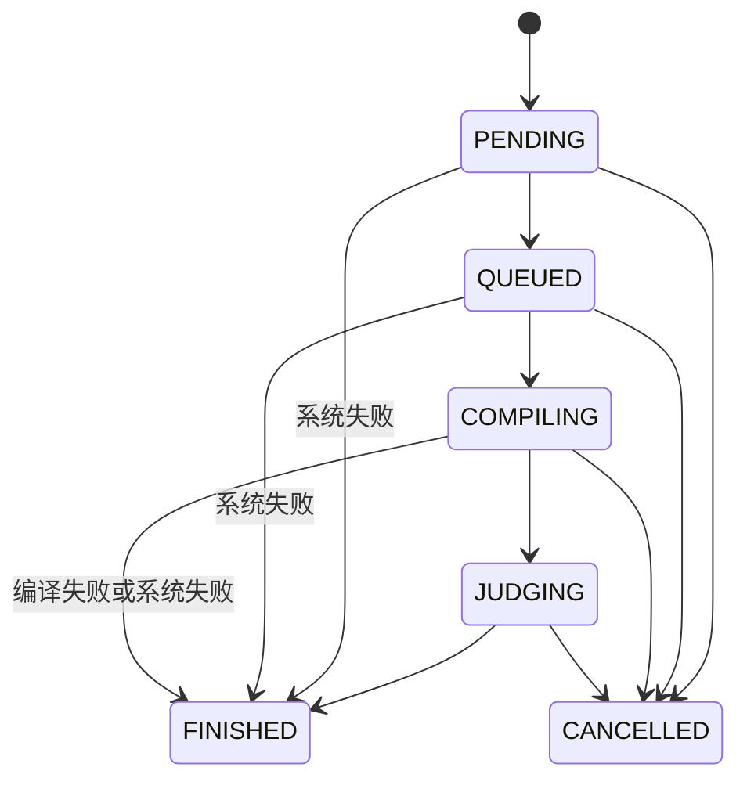

# JudgeRun 状态机与错误模型

状态：proposed / 0.1.0-draft。类型草案位于 internal/domain/state.go；当前没有 DB 状态持久化或任务执行。

## 生命周期与判题结果

将原文混合枚举拆为 RunState 与 Verdict；对外展示层可组合成原有状态名称。这能避免把 QUEUED 当作最终判题结果。

- 非终态的 verdict 为空。
- FINISHED 必须有非 CANCELLED 的最终 verdict。
- CANCELLED 的 verdict 必须为 CANCELLED。
- PENDING/QUEUED 直接 FINISHED 仅可 SYSTEM_ERROR；COMPILING 终止为 COMPILE_ERROR 或 SYSTEM_ERROR。
- JUDGING 允许 AC/WA/RE/TLE/MLE/OLE/IDLE/PARTIAL/SYSTEM_ERROR。
- 终态不可变。rejudge 新建 Run；Queue 重投不是 rejudge。
- CanTransition 只校验边方向，尚不能校验 verdict 组合、fence、事务竞争；存储实现前必须补齐这些约束。

Verdict：ACCEPTED、WRONG_ANSWER、COMPILE_ERROR、RUNTIME_ERROR、TIME_LIMIT_EXCEEDED、MEMORY_LIMIT_EXCEEDED、OUTPUT_LIMIT_EXCEEDED、IDLENESS_LIMIT_EXCEEDED、PARTIAL_ACCEPTED、SYSTEM_ERROR、CANCELLED。

## Attempt 与恢复（Phase 3 冻结）

QUEUED→COMPILING→JUDGING 是逻辑状态。Worker 重领可重新执行编译/运行，但不回退已持久化的逻辑状态；续行时应能跳过已过状态并验证前置产物，不把 helper 的 false 当作失败。采用新的 attempt/fence 防止旧 Worker 写回。已持久化终态的重复消息只确认存在并 ACK。

Pending reclaim 阈值、heartbeat 间隔、重试上限、死信处理、取消竞争和 fencing SQL 需在 Phase 3 Spec 固化；当前没有提供可直接运行的 Queue 实现。

## 分类

| 事件                                    | category / verdict                             | 说明                                          |
| --------------------------------------- | ---------------------------------------------- | --------------------------------------------- |
| 语法错误                                | USER / COMPILE_ERROR                           | 定位 SourceUnit 和 Role，截断诊断             |
| Contestant SIGSEGV                      | USER / RUNTIME_ERROR                           | 仅在可信退出与监督证据下                      |
| 用户进程超 CPU / wall / memory / output | USER / 对应超限                                | 记录 scope、观测值、限制                      |
| 编译资源超限                            | USER / COMPILE_ERROR（草案映射）               | reason=COMPILE_RESOURCE_LIMIT，保留预算和角色 |
| Sandbox 崩溃、失去计量、数据库不可用    | INFRASTRUCTURE / SYSTEM_ERROR 或可恢复 attempt | 不伪装成用户错误                              |
| Interactor / Checker 异常               | 依据其信任模型                                 | Phase 5/7 冻结，不默认判选手 RE               |
| 显式取消                                | CONTROL / CANCELLED                            | 完成图清理并在竞争条件中只接受一份终态        |

结果事务提交 → ACK。ACK 前崩溃：重投读到终态并 ACK；提交前崩溃：新 attempt 恢复。数据库事务/Outbox/Fencing 将在真实 Queue 阶段注入故障验证。
