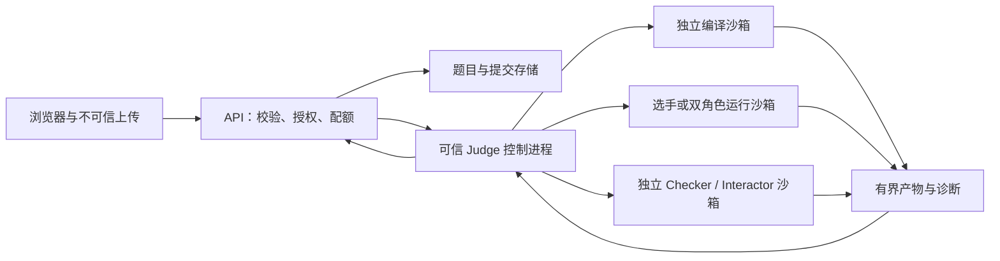

# 恶意代码安全风险与解决方案

起草：2026-10-07；补齐：2026-10-08。关联 SEC-001 与[后续工作包](../planning/2026-10-07-implementation-backlog.md)。本文是针对当前代码的防护盘点、整改方案和验收设计，**不是安全认证，也不表示整改已实施**。真实 Docker 验收仍待正常环境恢复；既有本地回归不能证明容器边界有效。

## 1. 信任边界与当前适用范围

选手 C++、教师上传的 checker、将来的 validator/generator/参考解、程序输出和上传文件都视为不可信内容。教师获得发布权限不意味着其程序可在 API 或宿主运行。需要保护宿主与其他任务、隐藏答案、其他人的源码、服务凭据、判题结果和服务可用性。

当前仅供本机手动模式演示，API 根据 `X-OJ-Mode` 投影结果；任何可调用 API 的本机客户端均可自行选择教师/工程师模式。它没有真实身份隔离。学生 DTO 不返回隐藏数据，是已经实现的展示边界；不能由此推出学生无法伪造模式获得详细结果。

上图是统一隔离的目标。当前旧 compile-only 服务是例外，详见 SEC-002。Judge 控制进程可控制 Docker，属于高权限可信计算基；容器内部、API、浏览器均不应取得 Docker socket/凭据。未来 worker 跨机器部署须增加服务身份和网络隔离，不能把本机无鉴权接口直接暴露。

## 2. 代码已经具备什么，仍缺什么

依据文件而非运行猜测：

| 边界               | 当前代码证据                                                                                                                                                                                                                | 缺口 / 不能宣称的能力                                                                                     |
| ------------------ | --------------------------------------------------------------------------------------------------------------------------------------------------------------------------------------------------------------------------- | --------------------------------------------------------------------------------------------------------- |
| filejudge 容器创建 | [docker.go](../../internal/filejudge/docker.go)：UID/GID 10002、只读根、network none、cap-drop ALL、no-new-privileges、private IPC/cgroupns、init、无 Docker 日志；内存/禁 swap/PID/CPU/文件/FD/tmpfs 限制                  | 当前版本真实环境未复验；普通容器仍共用宿主内核；未部署 gVisor/微虚机                                      |
| 编译隔离           | [engine.go](../../internal/filejudge/engine.go)：新容器、512 MiB、64 PID、默认阶段 20 秒、32 MiB 产物；仅挂源码，helper 使用固定参数                                                                                        | 此配置只覆盖 filejudge，旧 compile-only 不同；资源超限目前是 SYSTEM_ERROR，不擅自改为 CE                  |
| 运行配置验证       | `verifyContainer` 核对多数 inspect 字段；`Preflight` 实际检查 cgroup 值、CapEff、NoNewPrivs、Seccomp=2、无外网接口、只读根、无答案/源码/Socket暴露                                                                          | bind Source 未比对；tmpfs 接受任意目标；ulimit/shm 未核对。Seccomp=2 只证明过滤模式，不证明具体规则版本   |
| 生命周期           | 独立清理预算、label/run 身份核对、kill/inspect/rm/再查；不确定清理标记 tainted 并拒接单                                                                                                                                     | Linux 进程树、退出竞态、当前通信版本仍须真实验收；不能靠重启清除 tainted 就认定恢复                       |
| 资源及输出         | 单 Engine 单并发；有界 raw stdout/stderr、显示截断；通信通道有字节上限与共同截止时间                                                                                                                                        | 没有跨服务全局预算、持久排队配额、真实 Job 聚合峰值；CPU time/peak null，不能相加角色峰值冒充测量         |
| 上传               | [upload.go](../../internal/problemstore/upload.go)、[store.go](../../internal/problemstore/store.go)：文件白名单、严格 descriptor、64 KiB 单文件、1 MiB 内容总量、最多 17 parts；根目录约束、普通文件/身份检查、发布 marker | 无教师身份、累计存储配额/磁盘低水位/用户速率；没有 ZIP 导入功能，不应新增自动解压                         |
| 结果和界面         | [modes.go](../../internal/httpapi/modes.go) 白名单投影；React 文本渲染；worker 结果绑定源码/题目/产物/版本                                                                                                                  | 直接调用本地 worker 可得到完整 Result；未来会话、缓存、下载和历史接口也须授权；不是隐藏数据的绝对保密保证 |
| 镜像与追溯         | runtime 使用已解析 image SHA；拒绝镜像声明 VOLUME；固定编译参数                                                                                                                                                             | image SHA 不证明无漏洞；运行镜像仍包含工具链文件；宿主/daemon/runtime/镜像更新和漏洞处置未形成生产流程    |

独立静态证据与限制见[安全差距审阅](../reviews/2026-10-07-security-gap-review.md)。本节不将潜在风险冒称已成功利用。

## 3. 按恶意行为逐项设计防护

P0：接受非维护者任意代码或多人访问前必须解决；P1：扩大并发/长期运行前完成；P2：新增相应功能前完成。每项包含现有基础与尚待实施的措施，不能只靠源码关键词黑名单。

| 风险 ID / 行为                                            | 当前基础                                                              | 解决方案和必须验证的结果                                                                                                                                                     |
| --------------------------------------------------------- | --------------------------------------------------------------------- | ---------------------------------------------------------------------------------------------------------------------------------------------------------------------------- |
| M01 / 死循环、休眠、反复小输出拖延                        | filejudge wall deadline、CPU 配额、Job 总预算                         | P0：所有编译/运行/checker/relay均有外部截止时间；CPU 配额不等于 CPU 总时间限制。限时后完整回收，健康任务仍可执行。CPU 计量未落地前明确采用 wall，不虚报 CPU 时间             |
| M02 / 内存增长、mmap、共享内存和 swap 压力                | 各阶段 memory=memory-swap，受限 shm/tmpfs                             | P0：验证实际 cgroup 值和 OOM 证据；内存分配失败后正常退出不自动认 MLE。P1：Job 父层及节点保留预算，记录角色/聚合 OOM 归属；tmpfs 占用也计入预算                              |
| M03 / 进程或线程爆增                                      | pids-limit、init、阶段超时                                            | P0：编译入口统一；有上限的 fork/thread fixture 验证子孙进程也受限。父退出、setsid、忽略 TERM、持有管道的后代均不能留存；清理失败停池                                         |
| M04 / 无限 stdout/stderr、无换行巨行、二进制输出          | boundedStream 原始字节上限和显示截断                                  | P0：所有流共享/独立限额按契约计数，不无限读入内存，不按行无限缓冲；超限终止相关任务。存储、日志和 UI 另设显示限额，截断不改变 checker 使用的原始受限输出                     |
| M05 / 写大文件、海量小文件、FD 耗尽、core dump            | 只读根、tmpfs、fsize/nofile/core、PID 限制                            | P0：核对实际 tmpfs/ulimit/shm；P1：inode/总临时空间/主机 jobs 目录及日志配额；失败不拖垮 daemon。单文件 fsize 不等于目录总量限制                                             |
| M06 / 模板展开、预处理膨胀、巨大诊断、编译器漏洞          | filejudge 固定 g++ 参数及隔离编译                                     | P0：将 compile-only 接入同一受限阶段；请求大小限制和墙钟外加内存/PID/产物上限。不因“只编译不运行”放到常驻无预算进程；隔离中不放秘密文件，避免 include 诊断带出敏感内容       |
| M07 / 网络外连、DNS、扫描内部服务、云元数据读取           | filejudge network none；选手没有 worker HTTP网络                      | P0：旧编译入口补齐无网络；宿主防火墙/隔离节点第二层限制；外部配置 URL 不由用户控制。验证无外部出口与内部控制面连通性，不探测真实第三方目标                                   |
| M08 / 读取答案、其他源码、宿主凭据、Docker socket         | 固定只读挂载；选手不挂 expected；receiver 不挂 input                  | P0：对源与目标挂载白名单闭环，清空环境秘密，按角色最小输入视图；用专用 canary 验证，不能读取真实密钥。checker 可以读答案，但只能返回受控评分/反馈                            |
| M09 / 路径穿越、软链/硬链、设备/FIFO、路径替换竞态        | SafeFilename、os.Root、Lstat/普通文件及 SameFile检查、受限目录清理    | P0：补 Linux 链接/替换测试（Windows 跳过不算 PASS）；挂载前锁定本次不可变快照，拒绝异常文件类型及跨根指向；恢复清理只能作用于已核对 run 所有权的目录                         |
| M10 / namespace/mount/ptrace/BPF 等危险调用及内核漏洞     | capabilities 清空、NNP、seccomp模式探针                               | P0：记录编译和运行策略版本并验证实际生效；限制不必要系统调用且保留合法 C++兼容。专用节点无业务凭据、及时更新；评估 gVisor/微虚机增加隔离层，不能保证防住所有零日或硬件侧信道 |
| M11 / 伪装退出、杀父进程、僵尸、退出与超时竞态            | supervisor + Docker 状态 + 独立清理                                   | P0：程序自报内容不作为资源/退出证据；137 不自动认 OOM；所有匹配角色容器不存在后才释放任务。后续池复用前需要独立健康检查，未知残留保留证据                                    |
| M12 / 恶意 checker 吃资源、读写额外文件或伪造成功         | 上传 checker 独立容器、只读 input/answer/output、预算和非协议失败 SYS | P0：执行隔离和题目正确性分开。始终返回 AC 的 checker 仍可能正常退出，需 NEXT-005 草稿/多合法答案/已知错解/发布审核；checker 的输出不能当 HTML 或学生调试日志                 |
| M13 / 交互不 flush、永不 EOF、写阻塞、过多查询、异常协议  | 固定协议监督、截止时间、bounded transcript                            | P0：双方先退出、空消息、超长消息、额外 token、非 UTF-8、写端阻塞均有确定处理；协议/选手错误与 interactor 内部失败分开。不能无限等待对方“善意结束”                            |
| M14 / 通信超量、sender 洪泛、receiver 不读/早退、角色混淆 | 两份源码显式绑定、独立产物、受控单向中继、共享 deadline               | P0：按原始字节累计 observed/transferred，恰好上限与多1字节分开；不读时中继仍有界并可取消；取消两个角色及子孙。当前超通道上限按通信契约 WA；总输出超限另按 OLE                |
| M15 / 绕过通信规则、预计算/共享答案、时间侧信道           | 双角色隔离、无共享可写卷，固定公开 A+B 示例                           | P1：明确题目输入可见性和评分规则；A+B不证明 receiver 完成加法。同一作者可设计两端，不承诺防止协议层串通；私有双端输入另设计，隐藏答案减少反馈侧信道                          |
| M16 / 伪造 teacher/engineer、直接调用 worker、读别人提交  | 当前仅演示模式投影，worker loopback                                   | P0 多人前：真实会话 + 每个题目/提交/Run/下载对象授权；模式只影响界面。worker仅接受可信API/调度器身份、内网隔离且不发布公网端口；学生伪造模式头不得提权                       |
| M17 / 海量合法提交/上传、慢请求、反复取消、抢占队列       | body/read超时、单worker拒忙、单次上传上限                             | P1：用户/IP/课程/节点分层准入、待处理队列上限、累计存储/题数配额、并发原子预留和清理预算；取消不提前释放容量。健康检查不被昂贵请求饿死                                       |
| M18 / 上传恶意文件、ZIP炸弹、名称欺骗、重复发布           | 只接固定格式文本和严格 manifest，无 ZIP入口                           | P0：继续拒绝未支持的包格式与可执行文件；扩展解压时先定义展开大小/文件数/层级/链接/路径限制。发布原子可见、失败草稿不可见；下载走授权 ID映射，不暴露物理路径                  |
| M19 / XSS、ANSI/控制字符、日志伪造、隐藏数据借诊断流出    | JSX文本渲染、有界输出、学生汇总投影                                   | P1：诊断/transcript按文本处理，控制字符可视化；日志结构化脱敏，禁止终端解释转义序列。未来富文本用严格 sanitizer/CSP；账号/模式切换销毁明细缓存                               |
| M20 / 伪造 worker结果、旧Run回写、缓存污染                | worker响应严格DTO、source/testdata/artifact绑定                       | P0/P1：服务身份、result签收和持久终态条件更新；重判新增Run，attempt fencing；缓存键含所有源/工具/数据版本，不能仅按题ID；hash不替代调用方认证                                |
| M21 / 依赖/镜像污染、已知 runtime漏洞                     | 锁定工具版本、运行image摘要                                           | P1：SBOM/镜像来源/漏洞扫描/修补窗口、最小runtime镜像、凭据最小化、签名与允许清单；升级后重新兼容和资源验收。固定摘要只保证引用一致，不代表可信无漏洞                         |
| M22 / 将来AI提示被题面/输出指令操纵、泄露答案             | 当前未把LLM接入判题                                                   | P2：题面/源码/输出仅作为数据；学生提示上下文不放隐藏答案，不授予运行/发布/改分工具权限；verdict始终由确定判题器产生，教师可审阅撤销                                          |

## 4. 优先整改工作包

这些是拟实施任务，当前没有写入保护代码。改动涉及安全契约，必须先独立审阅，真实验证仍须正常授权 Linux 环境。

### SEC-002：统一仅编译入口（P0）

Owner：Backend Builder；Architect 设计和独立 Security Review。范围：compilation API/client、filejudge 编译适配、mvp启动器、旧 compiler 服务和部署说明。问题事实见[旧编译隔离差距](../issues/2026-10-08-compile-isolation-gap.md)。

方案：抽取受限 compile stage 供“仅编译”和正式判题复用。源码只能在新建阶段容器中处理；成功只返回编译信息，不执行产物；必须等待编译容器和临时产物清理确认后才释放预算。旧入口不可成为失败降级路径。短期在该适配完成前将其限制为维护者可信演示，不接受任意外部代码；不能仅给常驻服务加超时就宣称逐任务隔离完成。

验收：正常/CE、墙钟超时、内存/PID/诊断/产物超限、客户端断线、清理失败、连续两个任务不共享可写文件；无 Docker 或隔离不符时拒绝执行，API不调用 g++。确定 compile-only 原 timeout/compile_error 与新基础设施错误的兼容映射，不能偷偷改变旧 DTO。

### SEC-003：完整沙箱配置与实际限制验证（P0）

Owner：Architect + Sandbox Builder；独立安全审阅。范围：filejudge profile/inspect/preflight、镜像构建、专项测试。问题事实见[配置验证缺口](../issues/2026-10-08-sandbox-profile-verification-gap.md)。

以单一声明描述编译/运行/checker/交互/通信角色需要的 image、user、argv、mount、tmpfs、ulimit、shm、capability、seccomp、network、资源值。生成 Docker argv 与验证器共享数据结构，避免只维护参数不维护核查。bind Source 比对必须处理 Docker Desktop 主客路径表示差异，使用受审映射与实际 canary，不能盲用字符串放行或任意规范化路径；未知映射应拒绝。

对每个声明字段做独立 fake 故障注入：缺失/额外挂载、错误源、可写bind、错误tmpfs目标/大小/noexec、ulimit/shm缺失、镜像变更、安全选项异常均拒绝启动。真实探针再检查 mount/限制与代表性禁止操作。seccomp 默认策略可保留，但需固定所依赖 runtime/profile版本和证明内容；定制profile应兼容合法编译与执行，不能把 `Seccomp:2` 当作规则一致证明。

### SEC-004：身份、对象权限与内部服务边界（P0，多人前）

Owner：Backend Builder，Architect 审阅；Frontend Builder仅做会话/可见性。范围：API会话/授权、worker调用身份、内网部署、历史/下载/调试接口。

登录主体和角色从服务端取得。学生只看自己提交的公开摘要与自己源码；教师看所授课程/所管理题目范围；工程师调试有审计和最小权限。伪造模式头、跨对象ID和直接worker请求都不能绕过授权。采用 cookie 会话时设置安全属性和 CSRF 防护；精确 Host/Origin允许清单、CORS和本地服务访问策略一起验证。loopback 只限制网络监听面，不认证本机进程；CORS也不替代授权。

验收：学生伪造教师/工程师、换runID、直接worker、注销后缓存、过期会话、跨课程访问和无权限发布全部受控失败；反向代理只放行受审公开接口。当前本机演示保持原约定，实施多人版时再启用此门禁。

### SEC-005：全局准入、聚合计量和存储配额（P1，多人前）

Owner：Architect + Backend Builder。范围：准入服务、queue、存储、节点资源管理、工程师可观测性。

编译服务和judge共享节点容量账本；预算按编译/运行/双角色/控制进程开销预留，队列和取消清理也计费。上传单次限额之外增加用户/课程总字节、题数、版本保留和磁盘低水位；并发原子占额，写入失败释放，定期校验实际目录与账本。清理只针对自有已过期对象，不能删除现有未知题库或数据卷。

Job父层与角色子层cgroup需要单独受审实现；Docker CLI当前两个独立容器上限之和是结构预算，不是真实父cgroup或测得峰值。记录父层 memory.peak/事件与角色结果，分别报告 CPU、wall、内存；缺失证据不得编造。验收包括跨服务并发、磁盘逼近配额、取消风暴、队列满、OOM角色与父层归属、服务仍能拒绝/查询健康。

### SEC-006：Linux恶意行为回归与上线门禁（P0/P1）

Owner：Builder 实现，Worker 维护固定fixture，独立 Security Reviewer审结果。范围：专用 Linux 测试环境、脚本、证据和停止/恢复流程。测试程序只能运行在已通过正常预检的隔离测试节点；不能在开发宿主直接编译/执行攻击代码。

先完成低风险配置/fake检查，再逐个运行受控fixture，最后做小规模并发故障测试。不下载或运行内核漏洞利用代码，不向第三方扫描；使用临时 canary文件/专用拒绝出口。测试本身有独立总时间、总进程/内存/文件上限与带外停止手段，不用无上限的fork炸弹验证有无上限。

## 5. 可执行验收矩阵设计

全部为**待执行**的安全验收扩展；历史功能矩阵可以复用其中证据，但须逐条绑定同一源码/镜像/环境，不能整表套用历史 PASS。

| 组               | 输入/故障设置（受控）                                              | 期望与必须采集的证据                                                                                                                                                    |
| ---------------- | ------------------------------------------------------------------ | ----------------------------------------------------------------------------------------------------------------------------------------------------------------------- |
| T01 CPU/wall     | 有界计算耗时、sleep、忽略TERM的子进程                              | 按既定wall规则TLE；deadline/停止时刻、完整回收；后续正常题AC                                                                                                            |
| T02 memory/PID   | 低配额内递增内存、共享内存；有最大次数的子进程/线程创建            | 实际限制生效；OOM才按证据MLE；fork失败本身不乱判MLE；没有越界宿主影响                                                                                                   |
| T03 输出/文件/FD | limit-1/limit/limit+1字节，stdout+stderr合并；有界文件/FD增长      | OLE边界准确或按契约受控失败；峰值有界；日志/界面不无限膨胀                                                                                                              |
| T04 隔离         | 只读根写入、未挂canary读取、禁止出网、本测试禁用操作               | 访问被拒，合法I/O仍正常；记录mount、proc、cgroup事实，无真实凭据内容                                                                                                    |
| T05 编译         | 受控资源压力、巨大诊断、失败与成功、断线和清理失败                 | 新旧入口隔离一致；当前filejudge资源超限SYS；失败不带入下一任务                                                                                                          |
| T06 生命周期     | 父先退、后代持管道、取消与退出竞争、Docker inspect/rm失败          | 有限时间收尾；无法确认则SYSTEM_ERROR/tainted，停止接单；不清理未知owner                                                                                                 |
| T07 上传         | 穿越/重复名/超额part、缺文件、非法manifest、软链竞态、重复合法上传 | 400/413或配额拒绝；无半发布、无跨根读写；Linux未支持项明确SKIP不得PASS                                                                                                  |
| T08 checker/交互 | checker CE/超时/超输出/非法退出；交互双方先退/不flush/超查询       | 按冻结协议判SYS或选手错误；checker不能读非授权文件；已知错解不能被错误checker发布流程忽略                                                                               |
| T09 通信         | 正确A+B、角色缺失/重复、边界字节、receiver不读/早退、sender不停写  | 与COMM契约一致，channel超限WA；两个角色都停止。transferred≤byte_limit；observed可以超限并触发终止，缓冲/展示有界；回放若称accepted应明确映射transferred，不表示对端消费 |
| T10 权限/UI      | 伪造角色、跨用户/课程、直连worker、控制字符和HTML文本              | 未授权失败；仅允许字段返回，缓存/下载不泄密，浏览器不执行输出内容                                                                                                       |
| T11 容量/恢复    | 队列满、全局占额、存储低水位、旧attempt回写                        | 429/503/配额错误准确；不重复终态；取消任务清理前不释放预留                                                                                                              |
| T12 环境故障     | 关闭所需controller、替换profile字段、缺镜像、控制通道失败          | 启动/接单失败关闭；不普通进程降级；保留错误并需复验才能恢复                                                                                                             |

每例证据字段：fixture ID与hash、源码集合hash、runtime image/profile版本、内核/Docker/runtime/cgroup信息、Run/角色、资源上限、实际结束原因、原始字节数与截断、OOM/退出/kill证据、清理前后自有容器/Job目录、后续健康题结果、实际命令/退出码、PASS/FAIL/SKIP/NOT_RUN及原因。证据使用测试数据，公开文档不包含真实隐藏答案或凭据。

## 6. 判定与安全事件不能混淆

- 普通编译语法错误是 CE；当前 filejudge 编译超资源或helper异常是 SYSTEM_ERROR，checker编译/运行异常也是 SYSTEM_ERROR。若未来需要单列编译资源错误，先修契约和前端，再实现。
- wall超限按TLE；Docker/cgroup可信OOM证据按MLE；137也可能是监督器杀进程，不能只凭退出码判MLE。SIGSEGV等自然异常一般RE；协议错按对应题型契约。
- 正常输出资源超限按OLE；通信通道字节超限当前为WA。用户stdout里写“AC”或伪造JSON不构成平台结果，平台只信受控运行和checker协议。
- 配置不符、启动/控制通道异常、题库读取失败、资源证据不足或清理不确定是基础设施错误；不把平台故障记为学生WA，也不继续在疑似污染节点接单。
- 判题正确性与执行安全分别验收：恶意checker能在资源限制内始终AC；正确答案程序也可能试图读额外文件。杀毒扫描、源码静态扫描或关键词过滤不能替代隔离与判题规则审查。

## 7. 环境分级与应急方案

| 使用阶段       | 开放条件                                                                                                                                                         |
| -------------- | ---------------------------------------------------------------------------------------------------------------------------------------------------------------- |
| 本机维护者演示 | 维持loopback与手动模式；只用明确可信的演示输入。文档说明旧编译差距和真实验收待办                                                                                 |
| 小班受控试用   | SEC-002/003/004/005适用项与T01–T12通过；专用Linux判题环境、真实身份/对象权限、内部worker不可直连、配额/恢复/审计完成                                             |
| 互联网任意提交 | 独立安全审阅；专用判题节点与控制面隔离、补丁/镜像来源/备份恢复流程、持续滥用测试、容量/监控/应急演练；评估增强runtime兼容/性能后选择，不把普通Docker视为绝对边界 |

发生清理不确定、越界访问迹象或疑似隔离突破：停止受影响worker接单；保留Run、镜像/策略摘要和脱敏日志，限制控制面连接；通知项目负责人并建立独立问题档案。不要自动删除所有容器/卷，也不要自动恢复污染实例。确认影响范围后按受审步骤重建专用节点、必要时轮换可能暴露的凭据；通过原失败用例、零残留和健康题复验，再由负责人恢复接单。

本轮已发现的静态差距没有证明发生实际入侵，不执行凭据轮换或主机重置。风险即使整改后也不能承诺覆盖所有未知漏洞和侧信道。

## 8. 官方依据与本项目推导

以下页面于本轮查阅；实现建议是结合当前代码的工程判断，不代表外部项目为本OJ背书。

- Docker说明daemon控制权和挂载配置属于关键攻击面，因此本项目把Docker控制进程与提交内容分隔，并要求专用环境：[Docker Engine security](https://docs.docker.com/engine/security/)。
- 容器默认没有资源上限，CPU配额与内存/swap需明确配置，因此不能把普通Compose当作已验收沙箱：[Resource constraints](https://docs.docker.com/engine/containers/resource_constraints/)。
- seccomp过滤系统调用且默认策略兼顾兼容性；本项目要求核对策略及实际生效，不能只核对一个模式位：[Seccomp profiles](https://docs.docker.com/engine/security/seccomp/)。
- cgroup v2提供层级资源控制、内存事件和峰值信息；Job聚合统计应来源于同一层级观测：[Linux cgroup v2](https://docs.kernel.org/admin-guide/cgroup-v2.html)。
- gVisor以减少不可信程序对宿主内核接口的直接暴露为目标，也说明侧信道等边界；在本项目只是待评估选择：[gVisor Security Model](https://gvisor.dev/docs/architecture_guide/security/)。Rootless是另一项减权措施，仍需单独验证资源控制和运行兼容：[Docker Rootless](https://docs.docker.com/engine/security/rootless/)。
- 上传应采用允许清单、授权、受控存储及大小限制；本项目进一步补累计配额和发布原子性：[OWASP File Upload](https://cheatsheetseries.owasp.org/cheatsheets/File_Upload_Cheat_Sheet.html)。
- 单请求限制不足以控制累计资源消耗，因此增加用户/节点预算和容量门禁：[OWASP API4 Resource Consumption](https://api-security.owasp.org/editions/2023/en/0xa4-unrestricted-resource-consumption/)。
